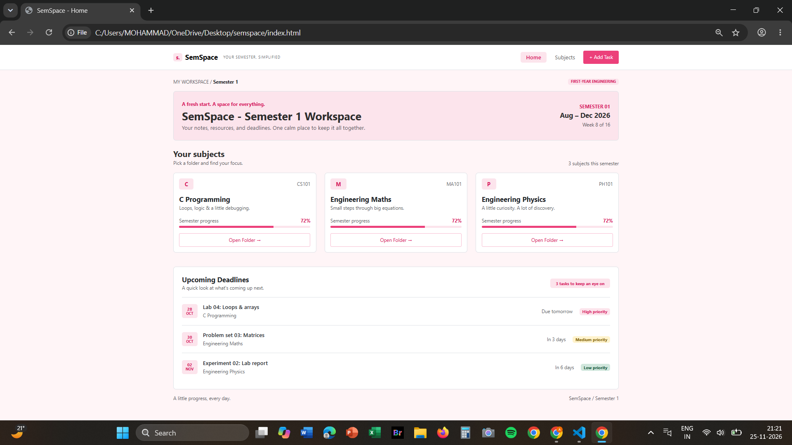
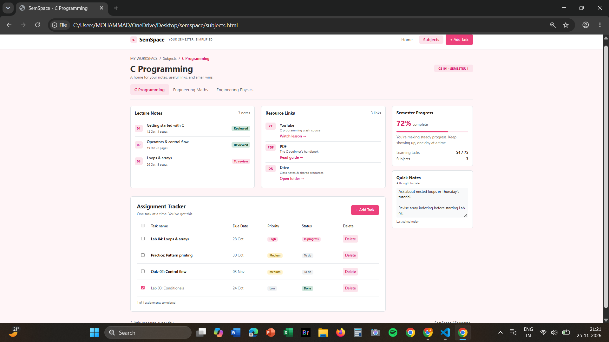
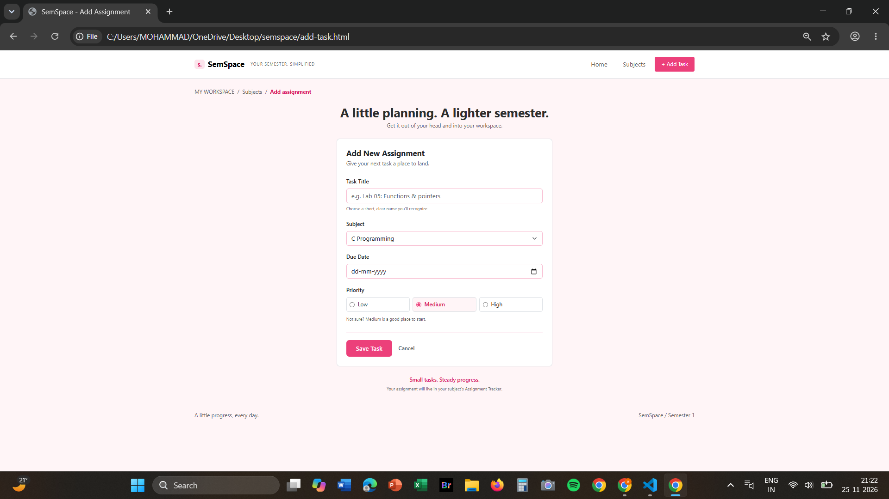

# SemSpace — Student Semester Dashboard

**SemSpace** is a Notion-inspired semester workspace designed for first-year Computer Science & Engineering (CSE) students to organize lecture notes, study resources, and assignment deadlines in one calm, pastel-themed interface.

---

## Figma Design & Interactive Prototype
- **Figma Prototype Link:** [View Interactive Prototype](https://www.figma.com/proto/1GKEw6LsKMKAyZvmiCDWIH/Untitled?node-id=35-8&p=f&t=bux7nTDWesrGyjUR-1&scaling=min-zoom&content-scaling=fixed&page-id=32%3A39&starting-point-node-id=35%3A2)
- - **Live Website:** [View Live SemSpace App](https://aamal-17.github.io/semspace/)
- **Design Process:** Low-fidelity wireframes, high-fidelity UI screens, and interactive screen-to-screen prototype navigation across 3 core views.

---

## Features
- **Home Dashboard (`index.html`):** Semester overview with subject cards, upcoming deadlines, quick statistics, and navigation.
- **Subject Workspace (`subjects.html`):** Subject-specific hub featuring Lecture Notes, Resource Links (YouTube, PDF, Drive), Semester Progress bar, Quick Notes, and an interactive Assignment Tracker.
- **Add Assignment (`add-task.html`):** Clean task creation form with subject selection, due date picker, and Low/Medium/High priority tags.
- **Persistent Task Management:** Uses browser `localStorage` so newly added assignments automatically save and appear in the Assignment Tracker, with one-click deletion.

---

## Tech Stack
- **Design & Prototyping:** Figma
- **Frontend:** HTML5, Bootstrap 5
- **Interactivity & Storage:** Vanilla JavaScript (`localStorage`)

---

## Screenshots

### 1. Home Dashboard

### 2. Subject Workspace & Assignment Tracker

### 3. Add Assignment Form

---

## How to Run Locally
1. Clone or download this repository.
2. Open `index.html` in any web browser.
